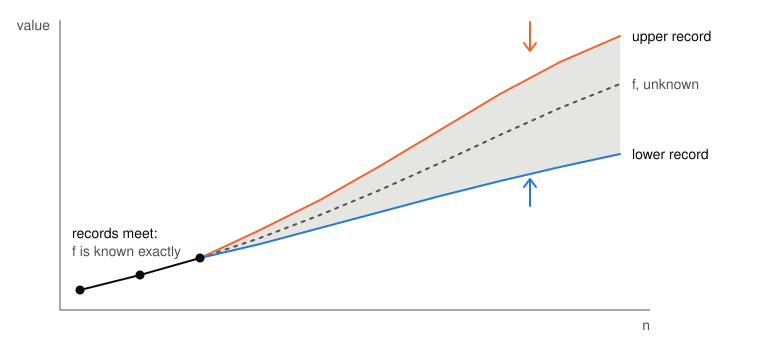

# SqueezeBench

[](lean-toolchain)
[](lakefile.toml)
[](LICENSE)

A benchmark of **Lean-verified bounds** on extremal combinatorics problems.

Each problem is a function `f : ℕ → ℕ` that cannot be (efficiently) computed in general: Ramsey numbers,
Schur numbers, cap sets, Golomb rulers. SqueezeBench keeps, for each one, the best proved
lower bound and the best proved upper bound, and squeezes `f` between them.

<p align="center">
  <picture>
    <source media="(prefers-color-scheme: dark)" srcset="docs/img/squeeze-dark.svg">
    
  </picture>
</p>

At every `n`, `lower record n ≤ f n ≤ upper record n`, proved in Lean. The picture is a
schematic, not data from one problem.

## How it works

A **record** is a Lean function `ℕ → ℕ` with a machine-checked proof that it bounds `f`.
To improve a record you submit a new function and three proofs:

| proof | says |
|---|---|
| `valid` | the new function still bounds `f` |
| `improves` | it is no worse than the current record at any `n` |
| `strict` | it is strictly better at some `n` |

So a record only ever improves, and every version of it is a theorem. An improvement can be a
single new value or a better formula for all `n`; both go through the same interface.

Submissions are judged by [Comparator](https://github.com/leanprover/comparator) against a
statement frozen for that version. Every proof is checked by two independent kernels: Lean's
own, and [nanoda](https://github.com/robsimmons/nanoda_lib), a re-implementation in Rust. No
`sorry`, no new axioms, no `native_decide`.

## Problems and leaderboard

For each problem: what `f` is, and who made the latest improvement to each record. A record builds on the versions before it, so the full credit is in each problem's
record history.

| problem | `f(n)` | lower record | upper record |
|---|---|---|---|
| [Ramsey](SqueezeBench/Problems/Ramsey) | least `N` such that every 2-colouring of `K_N` has a monochromatic `K_n` | [V013](SqueezeBench/Problems/Ramsey/Records/Lower/V013), trial claude-fable | [V002](SqueezeBench/Problems/Ramsey/Records/Upper/V002), trial claude-fable |
| [`R(3,k)`](SqueezeBench/Problems/Ramsey3) | least `N` forcing a red `K₃` or a blue `K_k` | [V007](SqueezeBench/Problems/Ramsey3/Records/Lower/V007), trial claude-fable | [V004](SqueezeBench/Problems/Ramsey3/Records/Upper/V004), trial claude-fable |
| [Schur](SqueezeBench/Problems/Schur) | largest `N` such that `{1,…,N}` splits into `k` sum-free parts | [V003](SqueezeBench/Problems/Schur/Records/Lower/V003), trial claude-fable | [V003](SqueezeBench/Problems/Schur/Records/Upper/V003), baseline claude-opus-5 |
| [Golomb rulers](SqueezeBench/Problems/Golomb) | least length of a Golomb ruler with `m` marks | [V008](SqueezeBench/Problems/Golomb/Records/Lower/V008), trial claude-opus-5.5 | [V013](SqueezeBench/Problems/Golomb/Records/Upper/V013), trial claude-fable |
| [Cap sets](SqueezeBench/Problems/CapSet) | largest cap in `F₃ⁿ` | [V005](SqueezeBench/Problems/CapSet/Records/Lower/V005), trial claude-fable | [V008](SqueezeBench/Problems/CapSet/Records/Upper/V008), trial claude-fable |
| [Roth](SqueezeBench/Problems/Roth) | largest subset of `{0,…,n−1}` with no 3-term arithmetic progression | [V009](SqueezeBench/Problems/Roth/Records/Lower/V009), trial claude-fable | [V007](SqueezeBench/Problems/Roth/Records/Upper/V007), trial claude-fable |
| [Ruzsa–Szemerédi](SqueezeBench/Problems/RuzsaSzemeredi) | most triangles in a locally linear graph on `n` vertices | [V008](SqueezeBench/Problems/RuzsaSzemeredi/Records/Lower/V008), trial claude-fable | [V008](SqueezeBench/Problems/RuzsaSzemeredi/Records/Upper/V008), trial claude-fable |
| [`ex(n; C₄)`](SqueezeBench/Problems/ExC4) | most edges in an `n`-vertex graph with no 4-cycle | [V008](SqueezeBench/Problems/ExC4/Records/Lower/V008), trial claude-fable | [V005](SqueezeBench/Problems/ExC4/Records/Upper/V005), trial claude-fable |
| [`ex(n; {C₃,C₄})`](SqueezeBench/Problems/ExGirthFive) | most edges in an `n`-vertex graph of girth at least 5 | [V011](SqueezeBench/Problems/ExGirthFive/Records/Lower/V011), trial claude-fable | [V006](SqueezeBench/Problems/ExGirthFive/Records/Upper/V006), trial claude-fable |
| [`ex(Qₙ, C₄)`](SqueezeBench/Problems/HypercubeC4) | most edges in a `C₄`-free subgraph of the `n`-cube | [V007](SqueezeBench/Problems/HypercubeC4/Records/Lower/V007), trial claude-fable | [V007](SqueezeBench/Problems/HypercubeC4/Records/Upper/V007), trial claude-fable |

Each problem's README has the definition, the known values, the current records and the full
record history. There is also a [Tutorial](SqueezeBench/Problems/Tutorial) problem, which only
exists to try out the submission pipeline.

## Quick start

### Requirements

| what | needed for | how to install |
|---|---|---|
| `git`, `curl`, `python3` | everything | your system package manager |
| Lean, through [elan](https://github.com/leanprover/elan), which provides `lake` | everything | follow the [official install guide](https://lean-lang.org/install/), or run `curl https://elan.lean-lang.org/elan-init.sh -sSf \| sh` |
| a C compiler | `bootstrap` | e.g. `sudo apt install build-essential` |
| [Rust](https://rustup.rs), which provides `cargo` | `bootstrap` | follow [rustup.rs](https://rustup.rs), or run `curl --proto '=https' --tlsv1.2 -sSf https://sh.rustup.rs \| sh` |
| Linux with Landlock, not as root | `verify` | check with `grep -w landlock /sys/kernel/security/lsm` |


### Setup

```sh
git clone https://github.com/leansolving/SqueezeBench.git # clone repo
cd SqueezeBench
lake exe cache get           # download prebuilt Mathlib
lake build                   # build the library and all records
lake exe squeeze bootstrap   # build the verifier tools into .tools/ (needs cargo)
```

`bootstrap` is needed once per machine, before `squeeze verify` can run.

## Contributing a record

```sh
lake exe squeeze new <Problem> <lower|upper>      # lay out the next version
# write Def.lean and Proof.lean, fill in REPORT.md and metadata.toml
lake exe squeeze verify <record-dir> --base upstream/main
```

Then open a pull request that adds your record directory and nothing else.
[`docs/CONTRIBUTING.md`](docs/CONTRIBUTING.md) has the full walkthrough.

## Repository layout

```
SqueezeBench/
├── Core/                  -- BoundFn, the three obligations, patch / maxWith / minWith
├── Problems/<Problem>/    -- Def.lean, README.md, Records/<Lower|Upper>/V<k>/
└── Tool/                  -- the `squeeze` tool
Challenges/<Problem>/      -- the trusted statement for each version, and problem.toml
Fixtures/                  -- records that must be accepted or rejected, for `squeeze test`
docs/                      -- guides
evaluation/                -- the AI baseline: prompts, runner, reports
scripts/                   -- builds the verifier tools
```

## Documentation

- [`docs/CONTRIBUTING.md`](docs/CONTRIBUTING.md): how to submit a record.
- [`docs/ADDING_A_PROBLEM.md`](docs/ADDING_A_PROBLEM.md): what a new problem must provide.

## Citing SqueezeBench

**TODO: add citation to the arXiV paper once available.**

## License

Apache 2.0. See [`LICENSE`](LICENSE).
